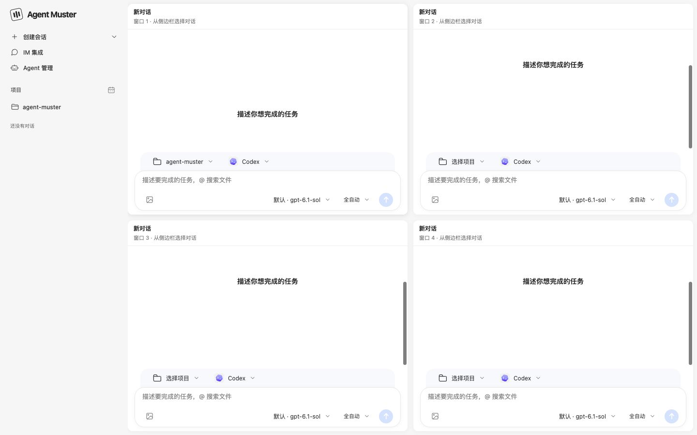
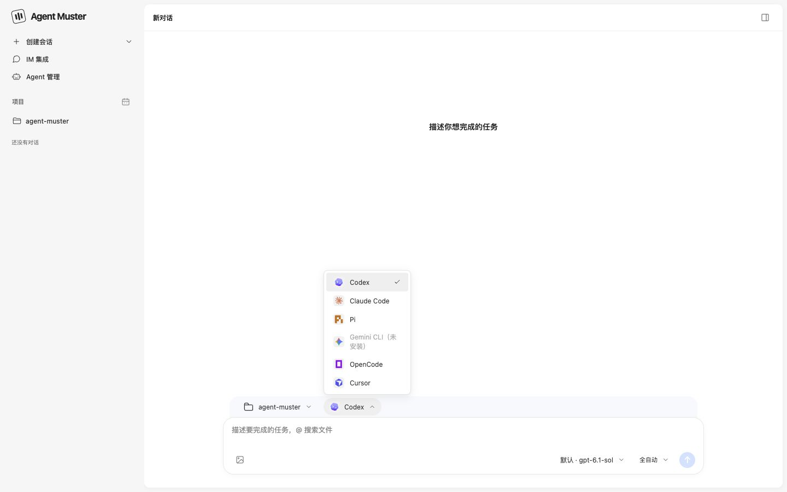
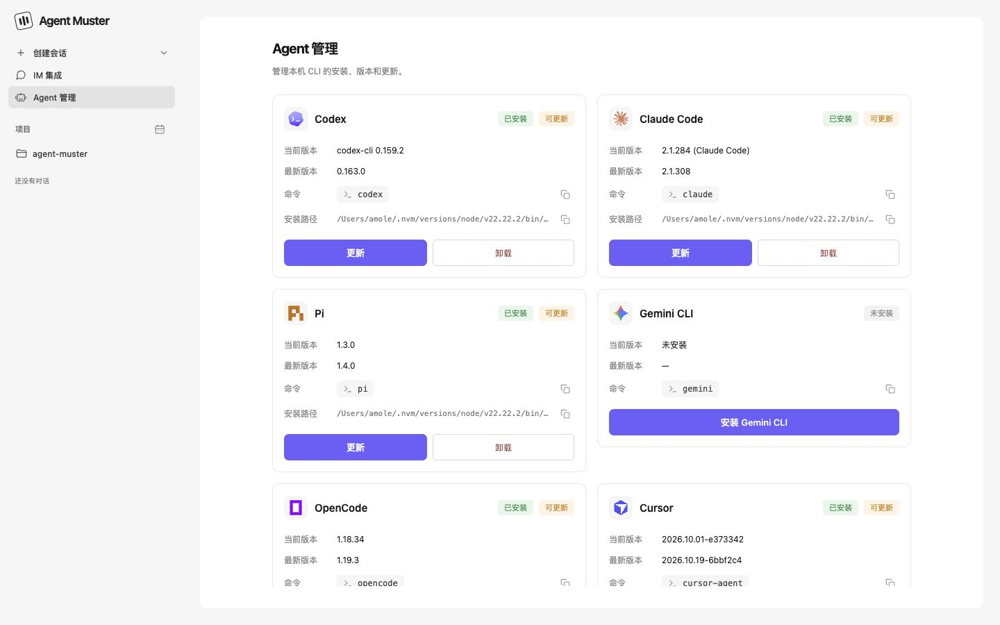
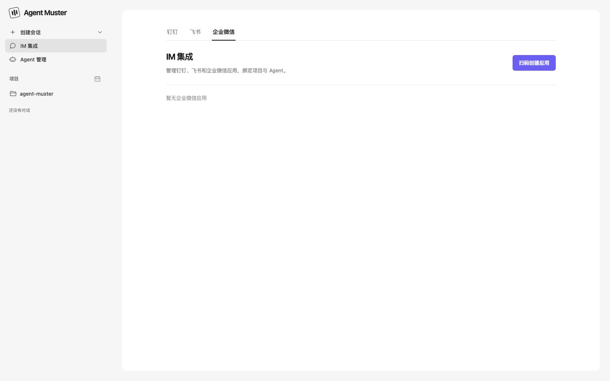
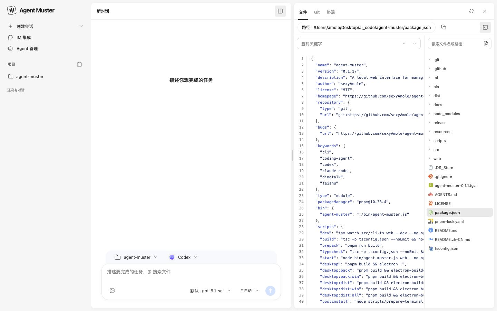

# Agent Muster


[English](./README.md) | 简体中文

在桌面端或本地浏览器中管理多个 AI 编码 Agent、项目和对话，也可以通过钉钉、飞书或企业微信机器人向 Agent 发送任务并接收回复。

[访问官网](https://sexyamole.github.io/agent-muster/) · [下载桌面端](https://github.com/sexyAmole/agent-muster/releases/latest)

## 功能

- 自动检测本机已安装的 Codex、Claude Code、Pi、Gemini CLI、OpenCode 和 Cursor。
- 按项目管理对话，支持单窗、双窗和四窗布局，同时查看和继续不同任务。
- 选择 Agent 和模型，实时查看回复、工具调用、执行状态及可用的 Token 用量。
- 保存项目和对话记录，支持继续对话和停止正在运行的任务。
- 在会话旁浏览和搜索项目文件、查看 Git 变更与差异，打开项目终端；输入 `@` 搜索并引用文件。
- 按会话选择权限模式与可用的内置沙箱，Agent 管理中显示当前版本和更新提示。
- 通过独立的 IM 集成页面，将钉钉、飞书和企业微信应用接入本地 Agent。

## 功能截图

### 创建任务与选择 Agent

在同一个输入区域选择项目、Agent、模型和权限，支持添加图片、粘贴截图以及输入 `@` 搜索项目文件。



### 多窗口布局

支持单窗、双栏和四宫格，每个窗口独立选择项目与 Agent。下图展示四宫格的新对话界面。


### Agent 管理

集中查看本机 Agent 的安装状态、版本和命令路径，并提供安装、更新和卸载入口。



### IM 集成

通过钉钉、飞书和企业微信页签管理应用接入，从「扫码创建应用」开始配置。下图展示尚未接入应用时的界面。



### 文件、Git 与终端

选定项目后打开右侧面板，在「文件」「Git」「终端」之间切换，可搜索文件名和内容、预览代码、查看暂存与未暂存差异，并直接运行项目命令。



## 环境要求

- Node.js **22.19.0 或更高版本**。
- 要执行任务，需要先安装并配置至少一个支持的 Agent CLI，并确保其命令在 `PATH` 中可用。
- Agent 的登录、模型权限和费用由对应服务管理。

| Agent | 检测的命令 |
| --- | --- |
| Codex | `codex` |
| Claude Code | `claude` |
| Pi | `pi` |
| Gemini CLI | `gemini` |
| OpenCode | `opencode` |
| Cursor | `cursor-agent` |

## 快速开始

### 桌面端

从 [GitHub Releases](https://github.com/sexyAmole/agent-muster/releases/latest) 下载适合系统的安装包：macOS Apple 芯片、macOS Intel 或 Windows 64 位。打开应用后，先确认至少一个 Agent CLI 已安装并完成登录。

### 命令行

无需全局安装，直接启动：

```bash
npx agent-muster
```

启动后会自动打开浏览器，默认地址为：

```text
http://127.0.0.1:17321
```

也可以全局安装：

```bash
npm install -g agent-muster
agent-muster
```

保持启动终端运行，按 `Ctrl+C` 停止服务。当前 Web 界面使用中文标签。

## 命令

| 命令 | 说明 |
| --- | --- |
| `agent-muster` | 启动 Web 界面并打开浏览器 |
| `agent-muster web` | 显式启动 Web 界面 |
| `agent-muster web --no-open` | 启动服务，不自动打开浏览器 |
| `agent-muster web --port 18000` | 指定监听端口 |
| `agent-muster agents` | 列出 Agent 及安装状态 |
| `agent-muster sessions` | 列出已保存的对话 |
| `agent-muster update` | 检查并更新全局安装到最新版本 |
| `agent-muster help` | 显示帮助，也支持 `--help` 或 `-h` |
| `agent-muster --version` | 输出当前版本后退出，也支持 `-v` |

`web` 命令可以省略，端口和浏览器选项可以组合使用：

```bash
npx agent-muster web --port 18000 --no-open
npx agent-muster -p 18000 --no-open
```

| Web 选项 | 说明 |
| --- | --- |
| `-p, --port <端口>` | 指定监听端口，必须是 1–65535 之间的整数，默认 17321 |
| `--no-open` | 启动服务，不自动打开浏览器 |
| `--dev` | 启用开发模式，需要源码及开发依赖 |

运行 `agent-muster web --help` 查看帮助。未知命令、不支持的参数及无效端口会在服务启动前报错。

服务仅监听本机地址 `127.0.0.1`，使用上述自定义端口时，请访问 `http://127.0.0.1:18000`。

## 创建第一个任务

1. 启动 Agent Muster，在 Web 界面点击「添加项目」，选择一个本地项目目录。
2. 点击项目旁的「新建对话」或顶部「创建会话」，选择已安装的 Agent、模型和权限模式。
3. 输入任务并发送，例如：`检查这个项目的启动流程，说明如何运行。`
4. 在对话窗口查看回复、工具调用和执行状态，继续发送消息完成任务。

Agent 在选中的项目目录中执行任务。模型列表取决于对应 CLI 的配置与可用权限。继续对话需要 Agent 已创建可恢复的会话。

## 文件与执行设置

- 选定项目后，打开会话右侧的项目面板。「文件」支持文件树、文件名和内容搜索及代码预览；「Git」显示工作区变更和暂存、未暂存差异；「终端」在项目目录中运行命令。
- 在消息中输入 `@` 搜索并引用项目文件；也可添加图片或粘贴截图。
- 点击输入区的权限设置，选择当前 Agent 支持的权限模式，并为支持内置沙箱的 Agent 设置当前会话沙箱。Codex 的只读、工作区写入和自动审核模式要求开启沙箱。
- 支持重命名会话、编辑用户消息、复制回复和查看运行日志。用量区域区分累计 Token 与 Agent 最近报告的当前上下文。

## IM 集成

在侧边栏打开「IM 集成」，选择「钉钉」「飞书」或「企业微信」。每个应用分别绑定项目和 Agent。

| 能力 | 钉钉 | 飞书 | 企业微信 |
| --- | --- | --- | --- |
| 创建应用 | 手机扫码创建 | 手机扫码创建 | 手机扫码创建 |
| 消息监听 | Stream SDK | SDK WebSocket 长连接 | 智能机器人 SDK 长连接 |
| 接收消息 | 文本、图片、图文 | 文本、图片、富文本图文 | 文本、图片、图文、语音转文字 |
| 对话场景 | 单聊、群聊提及机器人 | 单聊、群聊提及机器人 | 单聊、群聊机器人消息 |
| 消息回复 | 自动回复、Web 主动发送 | 自动回复、Web 主动发送 | 自动回复、Web 主动发送 |
| 聊天指令 | 新建对话、切换项目和模型、查询配置 | 同左 | 同左 |
| 应用管理 | 绑定项目、Agent 和权限，同步名称与图标 | 同左，可查看连接状态 | 绑定项目、Agent 和权限，查看连接状态 |

### 扫码创建与绑定应用

1. 先在 Agent Muster 中添加项目，确认目标 Agent 已安装并配置完成。
2. 打开「IM 集成」，选择平台，点击「扫码创建应用」。
3. 使用对应平台的手机应用扫描二维码，按授权页面提示完成应用创建和授权。二维码过期后可重新获取。
4. 为创建的应用选择项目、Agent 和权限模式。钉钉、飞书可点击「一键同步」更新平台上的名称和图标。
5. 向机器人发送单聊消息，或将机器人加入群聊并提及它发送任务。使用飞书或企业微信时，确认消息监听已连接。

接入期间需要保持 Agent Muster 运行，并能连接对应平台。本地服务通过 SDK 建立连接接收消息，无需提供公网 Webhook 地址。

### 接收任务与自动回复

收到任务消息后，Agent Muster 会在当前聊天选择的项目中调用应用绑定的 Agent，任务结束后将结果发送回原 IM 对话。首次聊天使用应用绑定的项目，之后可通过指令切换。

同一 IM 对话会继续使用已有的本地 Agent 会话，消息按顺序处理。在 Web 界面修改应用绑定的项目或 Agent，会清空该应用所有聊天的会话绑定和项目、模型配置；下一条任务消息将创建新的本地对话。

钉钉和飞书都支持独立图片及图文消息中的多张图片。图片会作为附件交给 Agent；只有图片时，会使用「请查看这张图片。」作为任务文本。群聊中需提及机器人，飞书可在同一条富文本消息中包含提及、文字和图片。

图片输入支持 Codex、Claude Code、Pi、Gemini CLI 和 OpenCode，所选模型也需支持图片。当前 Cursor 接入不支持图片附件，会回复明确提示。支持 PNG、JPEG、GIF 和 WebP 图片。

飞书下载用户发送的图片使用「获取消息中的资源文件」接口。新扫码创建的应用会申请 `im:message:readonly` 权限；已有应用需要在飞书开放平台开通该权限并发布应用版本。图片下载失败时，机器人会返回具体说明。

企业微信同样支持图片和图文任务，并可将平台提供的语音转文字内容作为任务提交；图片输入受相同的 Agent 与模型限制。

### IM 聊天指令

钉钉、飞书和企业微信使用相同的指令。在单聊中直接发送文本指令；群聊中需提及机器人后发送指令。每条指令单独发送，由 Agent Muster 直接处理，不会作为任务交给 Agent。

| 指令 | 说明 |
| --- | --- |
| `/new` | 解除当前聊天的会话绑定，下一条任务消息创建新对话；保留历史记录和当前项目、模型配置 |
| `/projects` | 列出已添加的项目，显示编号、名称和完整路径 |
| `/project 编号或完整路径` | 切换当前聊天的项目，下一条任务消息创建新对话 |
| `/models` | 列出应用绑定 Agent 的可选模型，显示编号、名称和模型 ID |
| `/model 编号或模型ID` | 切换当前聊天的模型，下一条任务生效，继续当前对话 |
| `/model default` | 恢复使用 Agent 默认模型，下一条任务生效 |
| `/status` | 查看当前项目、Agent、模型和本地对话 ID |
| `/help` | 查看指令说明 |

例如，先发送 `/projects` 查看列表，再发送 `/project 2` 切换到第二个项目；发送 `/models` 查看模型列表，再发送 `/model 1` 选择第一个模型。随后发送任务文本，例如 `检查这个项目的启动流程，说明如何运行。`。需要在当前项目开始独立任务时，先发送 `/new`，再发送新任务。

项目必须已在 Agent Muster 中添加，模型必须出现在当前 Agent 的可选模型列表中。编号以对应列表为准；项目也可使用完整路径，模型也可使用模型 ID。无效指令、项目或模型会返回说明，不会修改当前配置。

通过指令切换项目、模型或新建对话，只影响当前单聊或群聊，同群成员共享配置和对话，其他聊天不受影响。项目和模型配置会保存，服务重启后仍保留。指令与任务按顺序处理，已有任务执行中时，指令会等待前面的任务完成。

### 在 Web 界面主动发送消息

打开由 IM 创建的本地对话，在输入框旁选择发送方式：

- 「发送到钉钉」「发送到飞书」或「发送到企业微信」：以应用身份将输入的文本直接发送到关联的 IM 对话，不运行 Agent；发送记录保存在本地对话中。
- 「交给 Agent」：继续本地 Agent 任务，此模式不会将执行结果自动发送到 IM。

主动发送需要已有的 IM 对话映射。飞书发送较长的回复时会分成多条文本消息。

### 删除接入

点击应用条目中的「删除」，可移除本地接入并停止接收该应用的消息。已有对话记录会保留，对应消息平台中的应用不会被删除。

## 本地数据

项目、对话和 IM 接入配置保存在用户主目录下的 `.agent-muster` 中，重新启动后会读取已有记录。项目和会话按项目存放在 `projects/` 中；钉钉、飞书和企业微信应用凭证分别保存在 `im/dingtalk/apps.json`、`im/feishu/apps.json` 和 `im/wecom/apps.json` 中，请妥善保管这些文件。

## 常见问题

### Agent 显示未安装

在启动 Agent Muster 的终端中运行对应命令，确认 CLI 已安装且可以正常执行。安装或调整 `PATH` 后重新启动 Agent Muster。

### 默认端口被占用

通过 `--port` 指定其他端口：

```bash
npx agent-muster web --port 18000
```

### IM 机器人没有回复

确认本地服务仍在运行，已完成平台授权，应用已绑定项目和可用的 Agent。群聊中需要提及机器人；使用飞书或企业微信时，检查连接状态；飞书图片下载失败时检查 `im:message:readonly` 权限是否已开通并发布。可以在 Web 对话日志和启动终端中查看任务状态与错误信息。

### Web 界面无法主动发送消息

先从 IM 向机器人发送一条消息，再打开由此创建的本地对话。确认应用接入仍存在，项目和 Agent 绑定未被修改，并选择「发送到钉钉」「发送到飞书」或「发送到企业微信」后发送。

## 更新

查看当前运行的 CLI 版本：

```bash
agent-muster --version
agent-muster -v
```

启动 Web 服务时会在后台检查新版本，并在终端显示更新提示。

全局安装的用户可以运行：

```bash
agent-muster update
```

命令会检查最新版本，已有新版本时通过 npm 更新全局安装。更新完成后重新启动服务即可生效，也可以手动更新：

```bash
npm install -g agent-muster@latest
```

使用 `npx` 时，可以明确指定最新发布版本：

```bash
npx agent-muster@latest
```
